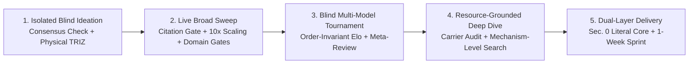

# Research Taste

**English** | [简体中文](README_zh.md)

[](LICENSE)
[](#quick-install)
[](#run-the-elo-auditor)

A distilled, cross-agent skill (`SKILL.md` + references + deterministic Elo/bias auditor) for turning narrow engineering patches into field-shaping, falsifiable AI & Embodied AI research directions—from zero-to-one ideation through multi-model blind tournaments down to resource-grounded falsification sprints.

---

## Why This Exists (Empirical Lessons)

Instead of assembling abstract prompt advice, we built and stress-tested this workflow on a real end-to-end top-venue topic-selection campaign by dissecting 5 open-source research-taste skills alongside Google DeepMind's *AI Co-Scientist* architecture and running 3 heterogeneous frontier models in physical isolation. Four hard empirical findings shaped **v2.0**:

1. **Single-model blind judging still exhibits strong implicit self-preference.** In a 9-candidate, 108-match fully blinded round-robin tournament with equal-length cards and all author/model tags removed, every frontier model still scored ideas originating from its own reasoning style **`+32` to `+46` Elo higher** than peer judges did. Cross-model blind judging is mandatory, not optional.
2. **One round of literature search is not enough.** Broad concept-level search during ideation reliably catches hot recent preprints, but misses both classic decades-old prior art and brand-new mechanism-level papers that only surface once an idea is grounded into a concrete system architecture. You need **two-stage live search** (broad concept sweep in Stage 2 + mechanism-level precision search in Stage 4).
3. **Decouple ideation from local hardware bugs, then recouple before committing.** Starting from local lab defects produces narrow patches; ignoring real compute/hardware constraints produces unbuildable plans. Good ideation separates the two phases explicitly.
4. **Metaphors and reviewer-defense boilerplate obscure the core idea.** Separating every final proposal into a **Section 0 (zero-metaphor, zero-formula literal core)** followed by isolated technical defense sections makes decisions dramatically sharper.

---

## Three Modes & Five-Stage Pipeline

Pick only the depth you need—no need to run a full tournament for a 5-minute sanity check:

| Mode | When to Use | Scope | Output |
|---|---|---|---|
| **L1 · Quick Taste Audit** *(5–10 min)* | You already have 1–3 ideas and want to check narrowness or collisions fast | Live search + 4-case citation gate + 10× scaling test + jargon-free restatement | Clear `Pursue / Reframe / Drop` verdict + primary kill risk |
| **L2 · Multi-Model Blind Tournament** | Brainstorming high-impact directions from scratch | Stages 1 → 2 → 3 (blind ideation + live graveyard sweep + isolated Elo + Meta-Review) | Order-invariant Elo table, self-preference audit, key judge disagreements & abstraction upgrades |
| **L3 · Resource-Grounded Deep Dive** | You picked Top 1–2 winners and want a buildable plan on real compute/hardware | Stages 4 → 5 (resource/carrier audit + mechanism-level search + 2-round critique + kill gates) | Model responsibility boundaries, rebuilt non-trivial delta, Day 1–3 kill gates & 1-week sprint card |



### Five Core Iron Laws
1. **Decouple ideation, recouple execution**: never frame a paper around a local lab/sensor bug; never commit without grounding in real compute/hardware boundaries.
2. **Two-stage live web/arXiv verification**: broad concept sweep before judging, plus mechanism-level classic + recent preprint search during resource grounding.
3. **No single-model self-judging**: physically isolate ≥2–3 heterogeneous models (no cross-file reads) and compute order-invariant Elo (`10,000` random match permutations) with self-preference auditing.
4. **Zero-metaphor, dual-layer writing**: ban metaphors and invented buzzwords; put the formula-free literal problem core in Section 0 and isolate reviewer defense afterward.
5. **Pre-registered conservative baseline & kill gates**: every winning proposal must include an intentionally conservative `A+B` lower bound and quantitative pass/stop thresholds before writing code.

---

## Quick Install

Works natively with **Claude Code**, **OpenAI Codex CLI**, and **Gemini / Antigravity** via the standard `SKILL.md` format.

```bash
# 1. Clone into your shared skills directory
git clone https://github.com/junwenxiong/research-taste.git ~/.agents/skills/research-taste

# 2. Symlink into whichever agent(s) you use
mkdir -p ~/.claude/skills ~/.codex/skills ~/.gemini/skills
ln -sfn ~/.agents/skills/research-taste ~/.claude/skills/research-taste
ln -sfn ~/.agents/skills/research-taste ~/.codex/skills/research-taste
ln -sfn ~/.agents/skills/research-taste ~/.gemini/skills/research-taste
```

Once installed, simply prompt your agent naturally—e.g.:
- *"Run an L1 research-taste audit on this paper idea..."*
- *"Run an L2 multi-model blind tournament to find high-taste directions for..."*
- *"Run an L3 resource-grounded deep dive on Candidate A using our current cluster/hardware..."*

---

## Run the Elo Auditor

`scripts/aggregate_elo.py` requires **zero third-party dependencies** (Python 3.8+ stdlib only). It parses pairwise `csv` vote blocks and optional 7-dimension rubric tables from each judge's Markdown file, then outputs:
- 10,000-permutation order-invariant pooled Elo (`±σ`) & Condorcet win-tie-loss standings
- Inter-judge agreement (exact match, non-tie agreement, Kendall $\tau$)
- Intra-judge self-consistency (rubric total score vs. pairwise Elo $\tau$ + high-gap inversion flags)
- Post-hoc blind self-preference audit (`Self − Peers` Elo delta via `--provenance`)

Try it immediately on the included synthetic demo dataset:

```bash
python3 scripts/aggregate_elo.py \
  --judges \
    Model1=examples/demo-tournament/JUDGE_MODEL_1.md \
    Model2=examples/demo-tournament/JUDGE_MODEL_2.md \
    Model3=examples/demo-tournament/JUDGE_MODEL_3.md \
  --cands A,B,C,D \
  --provenance examples/demo-tournament/provenance.json
```

---

## Repository Structure

```text
research-taste/
├── SKILL.md                               # Distilled 80-line core skill (v2.0)
├── README.md                              # English overview
├── README_zh.md                           # Chinese overview (简体中文)
├── CHANGELOG.md                           # Version history
├── LICENSE                                # MIT License
├── references/
│   ├── methods-playbook.md                # Distilled 5+1 research taste toolkit
│   ├── tournament-and-deepdive.md         # Blind card/CLI templates, L3 deep-dive Brief & writing/QA contract
│   └── domain-robotics.md                 # Pluggable Embodied AI / Robotics red-team gates
├── scripts/
│   └── aggregate_elo.py                   # Stdlib-only order-invariant Elo, consistency & bias auditor
└── examples/
    └── demo-tournament/                   # Synthetic runnable 4-candidate, 3-judge example
```

---

## Acknowledgements & Inspirations

This skill distills, cross-tests, and synthesizes practical mechanisms from:
- [`ky-ji/xie-saining-research-taste-skills`](https://github.com/ky-ji/xie-saining-research-taste-skills) (Understanding framing, Consensus Check, pre-run predictions & gradients)
- [`HughYau/pengsida-learning-research-skills`](https://github.com/HughYau/pengsida-learning-research-skills) (4-case citation gate, 1-hop citation traversal, intentionally conservative `A+B` lower bound)
- [`Orchestra-Research/AI-Research-SKILLs`](https://github.com/Orchestra-Research/AI-Research-SKILLs) (`21-research-ideation`: Boden creativity operators, hidden constraints & TRIZ inversion)
- [`Punktheory/research-idea-and-battle`](https://github.com/Punktheory/research-idea-and-battle) (Research Graveyard checks & timing triage)
- [`RealZYZhang/paper-reader-heilmeier`](https://github.com/RealZYZhang/paper-reader-heilmeier) (DARPA Heilmeier zero-jargon catechism)
- Google DeepMind, *Towards an AI Co-Scientist* ([`arXiv:2502.18864`](https://arxiv.org/abs/2502.18864)) (Pairwise Elo tournament & Meta-Review abstraction evolution)
