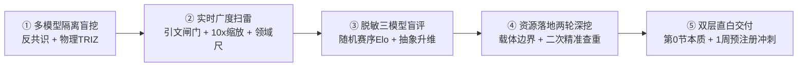

# Research Taste｜高品味研究选题与三模型真盲评 Skill

[English](README.md) | **简体中文**

[](LICENSE)
[](#快速安装)
[](#一键运行-elo-与偏见审计脚本)

一套面向 **Claude Code / OpenAI Codex / Gemini（Antigravity）** 的跨端共享研究选题 Skill（精简版 `SKILL.md` + 三份按需参考手册 + 零依赖 Elo/自偏好审计脚本），用于把“修自家系统的窄补丁”转化为经得起模型与算力缩放检验、且能在团队真实资源下快速证伪的高品味研究立项。

---

## 这套 Skill 是怎么做出来的？

我们没有凭空拼凑提示词，而是用一次真实的顶会论文立项当“实战试验场”迭代出来的：起初按常规方式基于存量项目做 Deep Research，发现产出的方向过窄、偏向局部工程补丁；于是现场拉取并逐字拆解了 5 套开源研究品味 Skill（谢赛宁、彭思达、Orchestra、研究坟场对战、DARPA Heilmeier）和 Google DeepMind `AI Co-Scientist` 架构，让三个异构前沿模型在物理隔离下按不同流派盲挖原始大题，经实时联网查重扫雷后，将 9 强脱敏改写为等长卡片跑了 108 场全轮转真盲评与 10,000 次随机赛序 Elo 复算，首次实证测出即便 100% 脱敏盲评、每个前沿模型对自产风格仍存在 **`+32` 至 `+46` Elo 的隐性自偏好**，同时靠实时查重和跨模型互审提前排掉了数个刚撞车或存在物理定义错误的“心头好”；随后把胜出的课题接回真实硬件与算力资源做两轮跨模型对抗深挖时，又暴露出“广度查重会漏掉具体机制层的经典先例与本周新论文”以及“比喻和审稿防御会淹没问题本质”两大痛点，最终把这两整轮实证跑通的机制、反例、脚本和表达纪律彻底蒸馏去私域化，沉淀成了今天的 **v2.0**。

---

## 核心能力：三档模式 × 五阶段流水线

按任务轻重选择对应档位，不用每次都打重型锦标赛：

| 档位 | 适用场景 | 执行范围 | 核心产出 |
|---|---|---|---|
| **L1｜快速品味体检**（5–10 分钟） | 已有 1–3 个想法，快速判断是否太窄或撞车 | 单端实时查重 + 四情况引文闸门 + 10× 缩放压测 + 零黑话重述 | `做 / 升维改题 / 换题` 明确裁决与最大死穴 |
| **L2｜多模型盲评锦标赛** | 从 0 挖大题、对比多路线、选出 Top 候选 | 阶段 1 → 2 → 3（隔离盲挖 + 广度扫雷 + 脱敏全轮转 Elo + 升维） | 随机赛序 Elo 榜、裁判一致性/自偏好审计、高张力分歧表与 Meta-Review 升维提案 |
| **L3｜资源落地两轮深挖** | 已锁定 Top 1–2，要落到团队真实资源立项开干 | 阶段 4 → 5（载体与资源边界 + 二次机制级精准查重 + 两轮互审 + 生死闸门） | 模型职责红线表、重构后的不可替代增量、D1–D3 生死闸门与 1 周预注册冲刺卡 |



### 五条实证铁律
1. **起题解耦、落地耦合**：发散与盲评期严禁从自家机台或局部字段补丁起题；终选立项前强制接回团队真实算力与硬件资源做载体边界审计。
2. **双阶段实时联网查重**：初筛做概念广度查重，落地到具体载体与算法后再做一次机制级精准查重（覆盖经典先例与近两周预印本）。
3. **禁止单模型自产自评**：由 ≥2–3 个异构底座物理隔离盲评，并用确定性 10,000 次随机赛序 Elo 与赛后自偏好审计消偏。
4. **零比喻、零造词、双层表达**：严禁生活/跨学科比喻与生造黑话；每份终选方案的**第 0 节**必须剥离公式与审稿防御，直白讲透输入、失败根因、核心改动与核心主张，审稿防御统一后置。
5. **预注册保守下界与硬止损**：每个终选方向必须绑定 1 条故意保守的常规组合下界及量化通过线/止损线，与保守下界打平即立刻止损。

---

## 快速安装

标准 `SKILL.md` 格式，直接兼容 **Claude Code**、**Codex CLI** 与 **Gemini（Antigravity）**：

```bash
# 1. 克隆到统一共享技能目录
git clone https://github.com/junwenxiong/research-taste.git ~/.agents/skills/research-taste

# 2. 按需软链到你使用的客户端
mkdir -p ~/.claude/skills ~/.codex/skills ~/.gemini/skills
ln -sfn ~/.agents/skills/research-taste ~/.claude/skills/research-taste
ln -sfn ~/.agents/skills/research-taste ~/.codex/skills/research-taste
ln -sfn ~/.agents/skills/research-taste ~/.gemini/skills/research-taste
```

安装后在任意客户端自然触发即可：
- “帮我用 `research-taste` L1 体检一下这个论文想法窄不窄、撞没撞车”
- “启动 L2 多模型盲评锦标赛，围绕 XXX 方向挖一批大题”
- “对终选方向做一次 L3 资源落地深挖，结合我们现有算力和系统给 1 周止损实验”

---

## 一键运行 Elo 与偏见审计脚本

`scripts/aggregate_elo.py` 仅使用 Python 3.8+ 标准库（零第三方依赖），自动解析各裁判 Markdown 报告中的配对 `csv` 代码块与可选 7 维打分表，输出随机赛序 Elo、Condorcet 胜场、裁判间一致性（Kendall $\tau$）、裁判内部“打分 vs 配对”自洽性以及赛后揭盲自偏好差值。

可直接用内置的合成示例数据试跑：

```bash
python3 scripts/aggregate_elo.py \
  --judges \
    Model1=examples/demo-tournament/JUDGE_MODEL_1.md \
    Model2=examples/demo-tournament/JUDGE_MODEL_2.md \
    Model3=examples/demo-tournament/JUDGE_MODEL_3.md \
  --cands A,B,C,D \
  --provenance examples/demo-tournament/provenance.json
```

---

## 仓库目录结构

```text
research-taste/
├── SKILL.md                               # 蒸馏至 80 行的主规范（v2.0）
├── README.md                              # 英文主说明
├── README_zh.md                           # 中文说明
├── CHANGELOG.md                           # 版本演进记录
├── LICENSE                                # MIT 开源协议
├── references/
│   ├── methods-playbook.md                # 5+1 流派分工与实操工具箱（50 行）
│   ├── tournament-and-deepdive.md         # 脱敏卡片、物理隔离 CLI、L3 深挖与双层交付契约（87 行）
│   └── domain-robotics.md                 # 具身智能与物理机器人可插拔红队模块（37 行）
├── scripts/
│   └── aggregate_elo.py                   # 零依赖随机赛序 Elo、自洽性与自偏好审计脚本
└── examples/
    └── demo-tournament/                   # 可直接运行的 4 候选 × 3 裁判合成演示集
```

---

## 致谢与方法来源

本 Skill 的机制拆解与融合受益于以下开源项目与研究工作：
- [`ky-ji/xie-saining-research-taste-skills`](https://github.com/ky-ji/xie-saining-research-taste-skills)（Understanding 视角、Consensus Check、跑前预测与梯度观）
- [`HughYau/pengsida-learning-research-skills`](https://github.com/HughYau/pengsida-learning-research-skills)（四情况引文闸门、引文图前后一跳核验、故意保守 `A+B` 下界）
- [`Orchestra-Research/AI-Research-SKILLs`](https://github.com/Orchestra-Research/AI-Research-SKILLs)（`21-research-ideation`：Boden 认知破局算子、隐藏约束解除与 TRIZ 反转）
- [`Punktheory/research-idea-and-battle`](https://github.com/Punktheory/research-idea-and-battle)（研究坟场扫雷与 Timing 三分）
- [`RealZYZhang/paper-reader-heilmeier`](https://github.com/RealZYZhang/paper-reader-heilmeier)（DARPA Heilmeier 零黑话问答）
- Google DeepMind, *Towards an AI Co-Scientist* ([`arXiv:2502.18864`](https://arxiv.org/abs/2502.18864))（配对锦标赛 Elo 与 Meta-Review 抽象升维）
